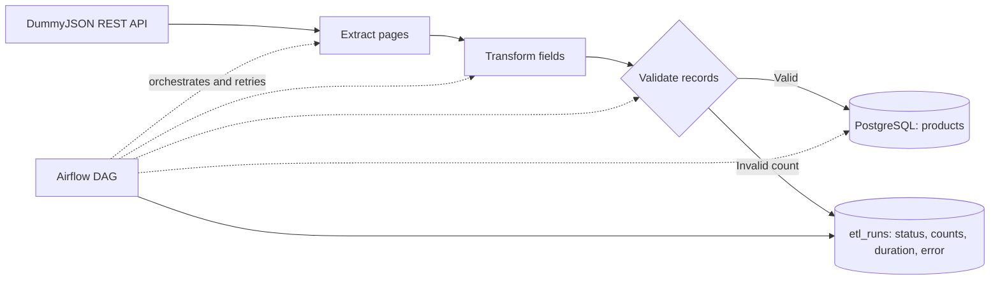

# End-to-End Data Engineering Pipeline

[](https://www.python.org/)
[](https://airflow.apache.org/)
[](https://www.postgresql.org/)
[](https://docs.docker.com/compose/)

A reproducible ETL pipeline that retrieves product records from the [DummyJSON API](https://dummyjson.com/products), applies transformations and data-quality checks, and loads valid records into PostgreSQL. Apache Airflow can run the same stages as a manually triggered, observable workflow.

## Project at a glance

| Area | Implementation |
|---|---|
| Source | Paginated REST API: DummyJSON products |
| Processing | Python extraction, transformation, validation and loading |
| Orchestration | Apache Airflow 3 DAG with task retries |
| Storage | PostgreSQL product table with idempotent upsert |
| Run observability | PostgreSQL `etl_runs` execution log |
| Local environment | Docker and Docker Compose |
| Validation checks | Required fields, numeric ranges and duplicate SKUs |

## Architecture

The diagram shows both the data path and the orchestration path. Airflow coordinates each stage and the monitor records the status and counts for every run.



## What the pipeline does

1. **Extract** — requests all product pages from DummyJSON and handles HTTP errors and request timeouts.
2. **Transform** — maps source fields to a stable product schema and replaces missing brands with `Unknown`.
3. **Validate** — accepts a product only when its title and SKU are present, price and stock are non-negative, rating is between 0 and 5, and the SKU is unique within the run.
4. **Load** — inserts valid products into PostgreSQL. Re-running the pipeline updates an existing row by `product_id`, so records are not duplicated.
5. **Monitor** — creates a run record and stores status, extracted/valid/invalid/loaded counts, duration, and an error message on failure.

The Airflow DAG is configured for **manual triggering** (`schedule=None`). Its stages are separate tasks, making task status and retries visible in the Airflow UI.

## Example execution

One recorded run in this project processed **194 products**: 194 passed validation, 0 were rejected, and 194 were loaded in approximately **2.64 seconds**. These are results from that run and will vary with API response time and the local environment.

## Repository layout

```text
.
├── dags/
│   └── products_etl_dag.py       # Airflow workflow
├── src/
│   ├── extract.py                # API extraction
│   ├── transform.py              # Source-to-target mapping
│   ├── validate.py               # Data-quality rules
│   ├── load.py                   # PostgreSQL upsert
│   ├── monitor.py                # ETL run tracking
│   ├── logger.py                 # Structured application logging
│   ├── pipeline.py               # Standalone pipeline entry point
│   └── tests/
│       └── test_validate.py      # Validation unit tests
├── init.sql                      # products table
├── create_etl_runs.sql           # monitoring table
├── docker-compose.yml            # PostgreSQL + one-shot ETL
├── docker-compose.airflow.yml    # Airflow + PostgreSQL services
├── Dockerfile
├── Dockerfile.airflow
├── requirements.txt
└── .env.example
```

## Run locally

### Option A — run ETL once with Docker Compose

Prerequisites: Docker Engine/Desktop with the Compose plugin.

```bash
git clone https://github.com/Salaheddine03-ux/end-to-end-data-engineering-pipeline.git
cd end-to-end-data-engineering-pipeline
cp .env.example .env
```

Edit `.env` and replace the placeholder for `POSTGRES_PASSWORD`. Then start the database and one-shot ETL service:

```bash
docker compose up --build
```

The ETL container exits after a successful run. Review its output with:

```bash
docker compose logs etl
```

Stop the services with `docker compose down`. Add `-v` only if you also want to remove the local PostgreSQL data volume.

### Option B — orchestrate with Airflow

Copy `.env.example` to `.env` and replace **all** placeholder passwords/secrets with local values. Start the Airflow stack:

```bash
docker compose -f docker-compose.airflow.yml up --build
```

Open [http://localhost:8080](http://localhost:8080), unpause `products_etl_dag` if needed, and trigger a run from the Airflow UI. The API server is bound to localhost in the Compose configuration. This setup is for local development; replace development credentials and review deployment security before exposing an Airflow service beyond your machine.

To stop the Airflow stack:

```bash
docker compose -f docker-compose.airflow.yml down
```

## Run the validation tests

With Python and the project dependencies installed:

```bash
pip install -r requirements.txt
pytest src/tests
```

## Data and configuration notes

- The pipeline calls the public DummyJSON demo API; its records are sample data and may change.
- Database connection settings are loaded from environment variables. Start from `.env.example` and keep your real `.env` file out of version control.
- PostgreSQL schema creation is handled by `init.sql`; the execution-monitoring schema is in `create_etl_runs.sql`.

## Skills demonstrated

Python ETL design · REST API pagination · data-quality validation · PostgreSQL schema and upsert · Airflow orchestration · Docker Compose · run monitoring · logging and failure handling
